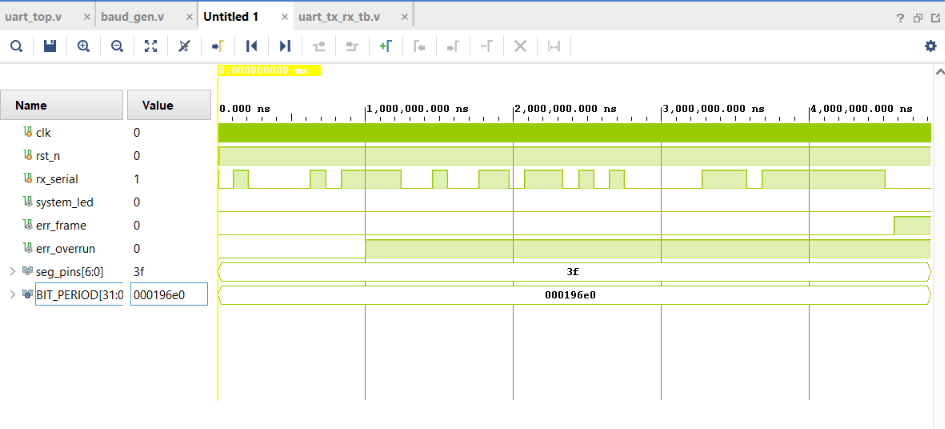

# Parametric UART Controller Subsystem with Hardware FSM & Error Matrix

A high-performance hardware description language (HDL) implementation of a **Universal Asynchronous Receiver-Transmitter (UART) Subsystem** designed in **Verilog RTL** and fully validated using **Xilinx Vivado**. The architecture is structured for high modularity, utilizing a 16x digital oversampling receiver, an autonomous finite state machine (FSM) command decoder, and a dedicated hardware error inspection matrix to capture real-time system anomalies without a microprocessor.

---

## 🛠 Features & Operations

This subsystem supports an 8-N-1 (8 Data bits, No parity, 1 Stop bit) serial protocol configuration, handling asynchronous bit serialization and multi-byte packet parsing natively in hardware gates.

### Supported Command Set

| Command Code (Hex) | Action | Target Peripheral | Category |
| :--- | :--- | :--- | :--- |
| `8'hA1` | **TOGGLE_LED** | Inverts the system state indicator LED | Control |
| `8'hB2` | **SET_7SEG** | Arms FSM to capture the next byte as numeric data | Configuration |
| `8'h00` - `8'h09` | **DISPLAY_DIGIT** | Drives segments to display active value (0-9) | Data Payload |

### Hardware Status & Error Flags
The subsystem dynamically generates critical status and diagnostic flags for error logging and boundary handling:
* **Data Valid Flag (DV):** Asserts high (`1'b1`) for exactly one clock cycle when a byte is successfully extracted and verified.
* **Framing Error Flag (Frame):** Asserts high when an incoming packet lacks a valid high (`1'b1`) Stop Bit, isolating line drops or baud mismatches.
* **Overrun Error Flag (Overrun):** Detects data collision bottlenecks where a new byte completes assembly before the previous byte has been cleared by the FSM.

---

## 📂 Repository Architecture

```text
UART/
├── UART.srcs/            # Hardware Source Tree
│   ├── sources_1/new/    # Design RTL Modules (baud_gen.v, uart_rx.v, uart_decoder.v, uart_top.v)
│   └── sim_1/new/        # Verification Suites / Testbenches (uart_tb.v)
├── UART.sim/             # Waveform Simulation Snapshot Configurations
├── UART.xpr             # Primary Xilinx Vivado Project File
└── README.md             # Subsystem Documentation
```

---

## 🚦 Verification & Testbench Setup

The module includes a robust testbench framework (`uart_tb.v`) designed to validate clean operations alongside protocol corner cases, short inter-packet delays, and intentional terminal bit violations.

### How to Run Simulation (Xilinx Vivado)
1. **Initialize Project:** Launch Xilinx Vivado and select **Open Project**, pointing to the `UART.xpr` file.
2. **Set Top Module:** In the **Sources** pane, expand the `Simulation Sources` hierarchy, right-click `uart_tb`, and select **Set as Top**.
3. **Run RTL Simulation:** Click **Run Simulation** from the left-side Flow Navigator toolbar, then choose **Run Behavioral Simulation**.
4. **Analyze Waveforms:** Use the `Waveform View` window, enter `run 5 ms` in the Tcl Console, and press **F** (Zoom to Fit) to analyze the bit streams and flag assertions.

---

## Simulation Output


---

## 💻 Future Enhancements
- [ ] Integrate a parameterizable Transmit (TX) engine for full-duplex loopback validation.
- [ ] Add hardware support for Parity Bit generation and verification (8-E-1 / 8-O-1 modes).
- [ ] Implement an Asynchronous FIFO ring buffer to isolate clock domain crossings (CDC).
